# Shopee at the Crossroads: Defend or Attack?
### A Business Development (BD) Assessment of Platform Strategy in the Era of Chinese E-Commerce

> **Central Question:** *Shopee ควรจัดสรรทรัพยากร (Resource Allocation) ระหว่าง "การป้องกัน Market Share" กับ "การรักษา Profitability" อย่างไร จึงจะรักษาตำแหน่งผู้นำตลาดในอีก 18 เดือนข้างหน้า?*
>
> **Target Audience:** Senior Leadership Team, Shopee (Thailand)  
> **Deliverables:** [1-Page Executive BD Memo (`memo.md`)](./memo.md) | 6 Analytical Jupyter Notebooks (`notebooks/`) | 13 Publication-Grade Charts (`charts/`) | Verified Public Datasets (`data/`)

---

## Executive Summary (บทสรุปผู้บริหาร)

ตลาด E-Commerce ในประเทศไทย (มูลค่า Core Platform GMV รวม **$30.7B** ในปี 2025 และกำลังเติบโตมุ่งสู่ระดับ **$42B+ Annualized** ในปี 2026) ได้เปลี่ยนผ่านจากยุคที่ Shopee ผูกขาดความเป็นผู้นำเดี่ยว (Single-Player Dominance) เข้าสู่สมรภูมิ **Two-Pole Market (สองขั้วอำนาจ)** อย่างสมบูรณ์:

1. **The Crossover Has Happened (จุดตัดประวัติศาสตร์เกิดขึ้นแล้ว):** ในไตรมาส **Q2 2026**, **TikTok Shop** ขยับแซง Shopee ขึ้นเป็นอันดับ 1 ในแง่ส่วนแบ่ง Quarterly Physical-Goods GMV ของไทยเป็นครั้งแรกที่ **48% ต่อ 45%** (ขณะที่ Lazada หดตัวเหลือ **7%**; *Cube Asia*)
2. **The Profit Squeeze Is Real (รายได้โตแต่กำไรหดตัวแรง):** แม้รายได้รวมของ Shopee ประเทศไทยจะพุ่งขึ้น **+76.9% YoY** แตะระดับ **88,387 ล้านบาท** ในปี 2025 แต่ **กำไรสุทธิ (Net Profit) กลับร่วงลงถึง -40.5% YoY** (จาก **4,630 ล้านบาท** ในปี 2024 เหลือ **2,756 ล้านบาท** ในปี 2025; *DBD*) สะท้อนภาระการเผาเงินทำ Promotion Subsidy และ Live Commerce เพื่อรักษา Market Share
3. **Sellers & Regulators Cap Fee Upside (เพดานการขึ้นค่าธรรมเนียมถูกจำกัด):** ผู้ขายรายย่อย (Micro/Small SMEs) แบกภาระต้นทุนบนแพลตฟอร์มสูงถึง **~34.7% ของยอดขาย** (เหลือ Net Margin เพียง ~8%) ประกอบกับกระทรวงพาณิชย์ได้มีมติปรับลดเพดานค่า **Mandatory GP** จากสูงสุด **19.26% ลงมาเหลือ 8.03%–13.91%** (ลดลงสูงสุด **-33.3%**) พร้อมแนวปฏิบัติ **TCCT Guideline 6 ด้าน** ของ กขค. ที่คุมเข้มเรื่องโครงสร้างค่าธรรมเนียมและ Algorithm
4. **The Strategic Solution (การจัดสรรทรัพยากรแบบ 50 : 30 : 20):** แทนที่จะเผาเงินสู้ศึก Subsidy War ทุกสมรภูมิ หรือกระโดดเข้าสู่สงคราม **Quick Commerce** ที่เสี่ยงขาดทุนหนัก Shopee ต้องจัดสรรทรัพยากรเชิงกลยุทธ์ในสัดส่วน **50 : 30 : 20** ได้แก่:
   - **50% (Core Defense):** ปกป้องฐาน **Intent-based Commerce (Search + Shopee Mall)** และยกระดับความเร็วของ **SPX Express**
   - **30% (Structural Moat):** เปลี่ยนลมหนุนจากกฎระเบียบภาครัฐ (**Import VAT 7%** สำหรับสินค้า `<1,500 บาท` + โครงการ **OTOP เรต GP 4%**) ให้เป็นฐานสินค้า Local Exclusive
   - **20% (Selective Attack):** รุก **Creator Affiliate & Live** แบบเจาะจงเฉพาะหมวดสินค้า **High-Margin** โดยคุมเพดาน Subsidy ต่อออเดอร์อย่างเคร่งครัด

---

## Story & Section-by-Section Analysis (การวิเคราะห์เจาะลึก 6 ส่วน)

### Section 1 — Market Shift: ตลาดเปลี่ยนไปแล้ว
**Business Question:** *Shopee ยังคงเป็นผู้นำตลาดแบบไร้คู่ต่อสู้เหมือนเดิมหรือไม่?*  
**Notebook:** [`notebooks/01_market_shift.ipynb`](./notebooks/01_market_shift.ipynb) | **Data:** [`sec01_gmv_quarterly.csv`](./data/processed/sec01_gmv_quarterly.csv), [`sec01_yoy_growth.csv`](./data/processed/sec01_yoy_growth.csv)

- **Key Findings:**
  - ในภาพรวมทั้งปี 2025 ตลาด Marketplace 3 เจ้าหลักในไทยมีมูลค่า GMV รวม **$30.7B** โดย Shopee ยังคงนำที่ **$15.9B (51.8%)** ตามด้วย TikTok Shop ที่ **$11.2B (36.5%)** และ Lazada ที่ **$3.6B (11.7%)**
  - แต่เมื่อดู **Quarterly Trajectory** ในช่วงครึ่งแรกของปี 2026 (H1 2026) ส่วนแบ่งตลาดของ Shopee และ TikTok Shop บีบเข้ามาเท่ากันที่ 46% : 46% และเกิดจุดตัด (**Crossover Point**) ใน **Q2 2026** ที่ TikTok Shop แซงขึ้นนำที่ **48.0% ต่อ 45.0%**
  - อัตราการเติบโต (**YoY Growth Rate**) ของ TikTok Shop สูงถึง **+53.4% YoY** ในปี 2025 (และเร่งตัวขึ้นเป็น **+75.0% Annualized Momentum** ใน H1 2026) ซึ่งเร็วกว่า Shopee (**+23.3% YoY**) กว่า **2.3 เท่า** ขณะที่ Lazada หดตัว **-30.8% YoY**

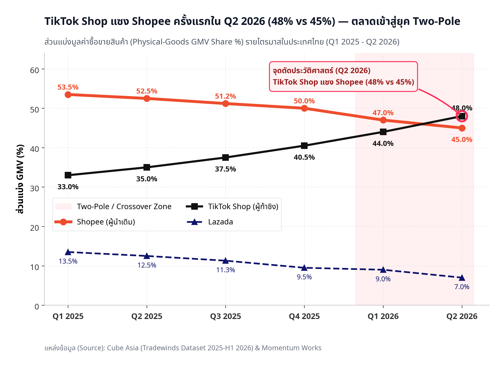

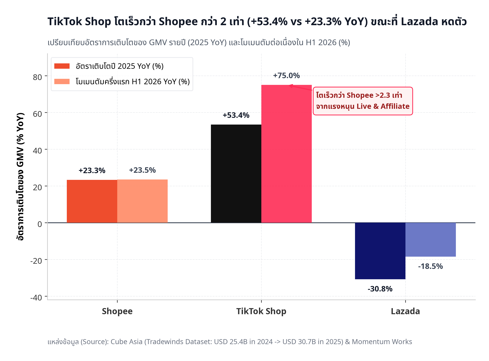

> **Section 1 Insight:** *"Shopee ยังนำในภาพรวมปี 2025 แต่ trajectory ชี้ชัดว่ายุคแห่งการเป็นผู้นำเดี่ยว (Single-leader dominance) จบลงแล้วใน Q2 2026"*

---

### Section 2 — Threat Landscape: ศัตรูไม่ใช่ก้อนเดียว
**Business Question:** *ภัยคุกคามที่แท้จริงต่อ Shopee คือใคร และ Business Model ของคู่แข่งแต่ละรายต่างกันอย่างไร?*  
**Notebook:** [`notebooks/02_threat_landscape.ipynb`](./notebooks/02_threat_landscape.ipynb) | **Data:** [`sec02_competitor_financials.csv`](./data/processed/sec02_competitor_financials.csv), [`sec02_threat_matrix.csv`](./data/processed/sec02_threat_matrix.csv)

- **Key Findings:**
  - **Financial Runway Asymmetry (เปรียบเทียบสายป่านและโครงสร้างกำไรจากงบ DBD ปีฐาน 2567):** Shopee ประเทศไทยมีฐานกำไรที่แข็งแกร่ง (**Net Profit +4,631 ล้านบาท** จากรายได้ **49,965 ล้านบาท** และยังมีกำไรจาก **SPX Express** อีก **+469 ล้านบาท** จากรายได้ 23,499 ล้านบาท) ในขณะที่ TikTok Shop ต้องยอมเผาเงิน **ขาดทุนสุทธิ -3,678 ล้านบาท** (จากรายได้ 12,066 ล้านบาท) เพื่ออัดฉีดคูปองและค่าคอมมิชชัน Affiliate ซื้อพฤติกรรมผู้บริโภค
  - **2x2 Threat Positioning Matrix:**
    - **TikTok Shop (*Structural Threat*):** ภัยคุกคามต่อ GMV สูงสุด (9.0/10) และตอบโต้ได้ยากที่สุด (8.4/10) เพราะเปลี่ยนพฤติกรรมการซื้อจาก **Intent-based (ตั้งใจค้นหา)** ไปสู่ **Impulse / Content-led Discovery (ดูคอนเทนต์แล้วซื้อทันที)**
    - **Temu (*Price Disruptor*):** เข้าตลาดไทยเมื่อ ก.ค. 2024 มียอดดาวน์โหลดสะสมทะลุ **10 ล้านครั้ง** (*AppMagic*) แต่ยังมี **GMV Share <3%** บทบาทของ Temu จึงไม่ใช่การแย่ง GMV ก้อนใหญ่โดยตรง แต่เป็นการกดเพดานราคาสินค้า Non-brand ส่งตรงจากโรงงานจีน (Factory-Direct)
    - **Lazada (*Traditional Rival*):** มีโมเดลธุรกิจแบบ Catalog / Intent-based เหมือน Shopee และกำลังถอยไปตั้งรับในกลุ่มแบรนด์ผ่าน LazMall เพื่อรักษาสถานะกำไร (+836 ล้านบาท)

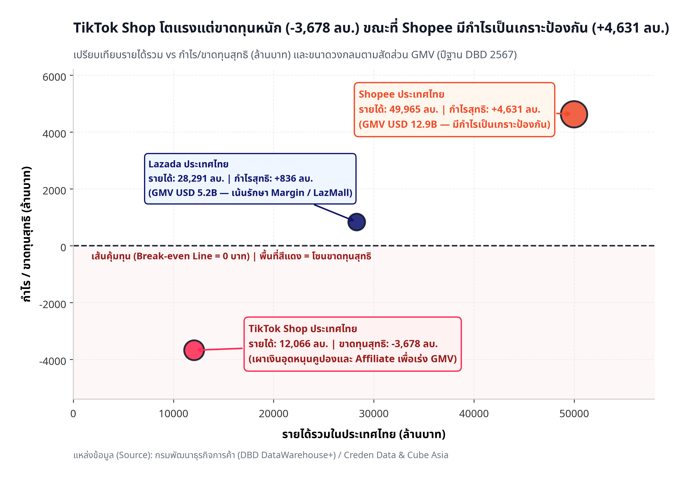

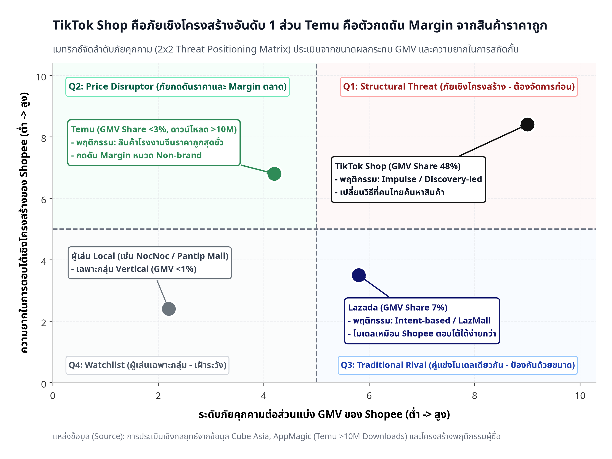

> **Section 2 Insight:** *"TikTok Shop คือภัยเชิงโครงสร้าง (Structural Threat) ที่ต้องจัดลำดับแรก; ส่วน Temu เป็นภัยเชิงราคา (Price Disruptor) ที่ยังเล็กในแง่ GMV แต่กดดัน Margin ทั้งตลาด"*

---

### Section 3 — Internal Pressure: Shopee แบกอะไรอยู่
**Business Question:** *Shopee มีทรัพยากรและพื้นที่ทางธุรกิจ (Headroom) พอที่จะเปิดศึกเผาเงินทุกสมรภูมิพร้อมกันหรือไม่?*  
**Notebook:** [`notebooks/03_internal_pressure.ipynb`](./notebooks/03_internal_pressure.ipynb) | **Data:** [`sec03_shopee_financial_trend.csv`](./data/processed/sec03_shopee_financial_trend.csv), [`sec03_seller_cost_burden.csv`](./data/processed/sec03_seller_cost_burden.csv), [`sec03_gp_reduction.csv`](./data/processed/sec03_gp_reduction.csv)

- **Key Findings:**
  - **Margin Compression (กำไรสุทธิหดตัว -40.5%):** ข้อมูลงบการเงินจากกรมพัฒนาธุรกิจการค้า (DBD) ชี้ชัดว่ารายได้ของ บจก. ช้อปปี้ (ประเทศไทย) เติบโตจาก **29,476 ล้านบาท (2023)** เป็น **49,964 ล้านบาท (2024)** และทะยานแตะ **88,387 ล้านบาท (2025)** แต่กำไรสุทธิในปี 2025 กลับลดลงถึง **-40.5% YoY** (จาก **4,630 ล้านบาท** เหลือ **2,756 ล้านบาท**) ส่งผลให้ **Net Profit Margin** บางลงจาก **9.3% เหลือเพียง 3.1%**
  - **Seller Cost Burden (ภาระต้นทุนผู้ขายตึงตัว):** ผู้ขายรายเล็ก (Micro/Small SME) ต้องแบกต้นทุนรวมบนแพลตฟอร์มสูงถึง **34.7% ของยอดขาย** (แบ่งเป็น Commission GP 12.5%, Shopee Ads 8.5%, Logistics 6.0%, Promo/Xtra Fee 4.5% และ Payment Fee 3.21%) ทำให้เหลือ **Net Margin เพียง ~8.0%** (เทียบกับร้านค้ารายใหญ่/Mall ที่เหลือ ~20.0%)
  - **Government GP Cap (รัฐกดเพดานค่าธรรมเนียม):** กระทรวงพาณิชย์ได้เจรจาให้ปรับลดเพดานค่า GP ภาคบังคับจากสูงสุด **19.26% ลงมาเหลือ 8.03%–13.91%** (ลดภาระผู้ขายรายย่อยสูงสุด **-33.3%**) ทำให้ Shopee ไม่สามารถใช้วิธีขึ้นค่า GP กับผู้ขายรายย่อยเพื่อชดเชยกำไรที่หายไปได้

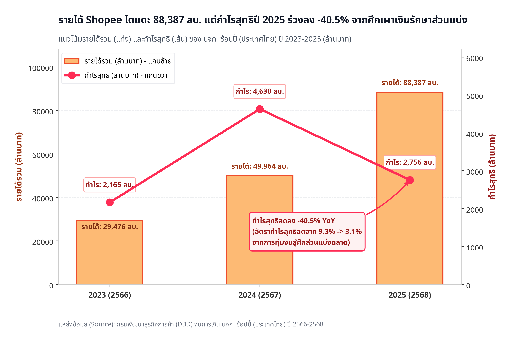

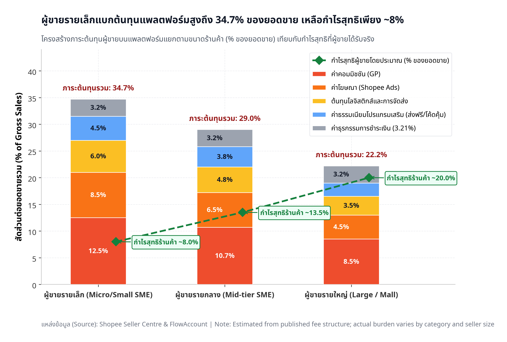

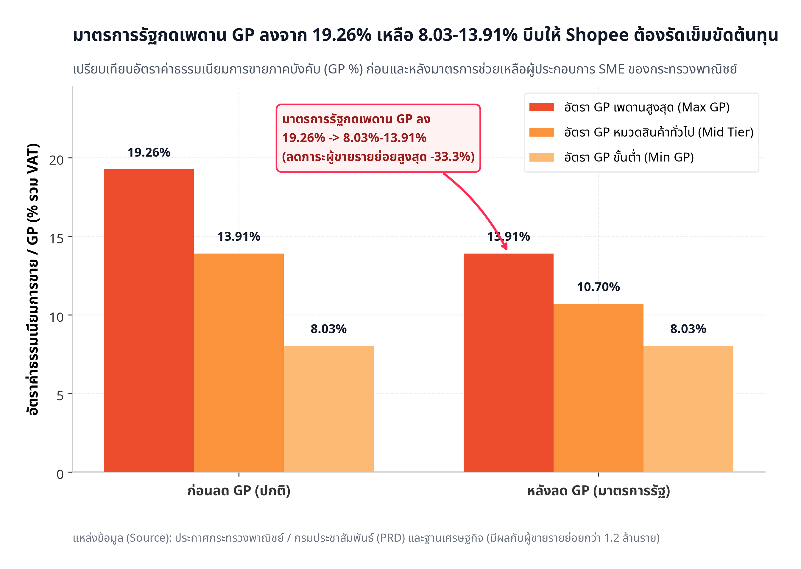

> **Section 3 Insight:** *"Shopee มีกำไรแต่กำลังบางลง (-40.5% YoY) ขณะที่ผู้ขายรายย่อยก็แบกต้นทุนหนักและรัฐคุมเพดาน GP — ทรัพยากรมีจำกัด จึงต้องเลือก Frontline อย่างแม่นยำ"*

---

### Section 4 — Regulatory Wind: กฎระเบียบเปลี่ยนเกม
**Business Question:** *กฎระเบียบใหม่ของภาครัฐกระทบใครหนักกว่ากัน และ Shopee สามารถพลิกเป็นโอกาสเชิงโครงสร้าง (Structural Moat) ได้อย่างไร?*  
**Notebook:** [`notebooks/04_regulatory_wind.ipynb`](./notebooks/04_regulatory_wind.ipynb) | **Data:** [`sec04_regulatory_heatmap.csv`](./data/processed/sec04_regulatory_heatmap.csv), [`sec04_cost_shift.csv`](./data/processed/sec04_cost_shift.csv)

- **Key Findings:**
  - **Import VAT 7% สำหรับสินค้านำเข้า `<1,500 บาท`:** มีผลบังคับใช้ตั้งแต่วันที่ 5 ก.ค. 2567 โดยกรมสรรพากรและกรมศุลกากรจัดเก็บ VAT 7% ตั้งแต่บาทแรกของราคา CIF ส่งผลกระทบโดยตรงระดับรุนแรงที่สุด (**Impact Score: 5/5**) ต่อผู้ขาย Cross-border จากจีนและแพลตฟอร์มอย่าง Temu
  - **TCCT Fair-Trade Guideline 6 ด้าน:** สำนักงานคณะกรรมการการแข่งขันทางการค้า (กขค.) กำหนดกรอบกำกับดูแลดิจิทัลแพลตฟอร์ม 6 ด้าน (ขอบเขตความรับผิดชอบ, ความโปร่งใสสัญญาและค่าธรรมเนียม, การป้องกันการแข่งขันไม่เป็นธรรม, การกำกับดูแล Algorithm / Self-preferencing, ธรรมาภิบาลข้อมูล และการระงับข้อพิพาท)
  - **แต้มต่อต้นทุน 11.3 Percentage Points ของโครงการ OTOP บน Shopee:** ในขณะที่ต้นทุนรวมของผู้ขาย Cross-border ขยับขึ้นจาก **18.5% เป็น 25.5%** โครงการ **"OTOP ไทยโตไกลกับ Shopee"** (ความร่วมมือกับกรมการพัฒนาชุมชน กระทรวงมหาดไทย) ได้ลดอัตรา GP เริ่มต้นเหลือเพียง **4.00%** พร้อมยกเว้นค่าธรรมเนียมโครงสร้างพื้นฐาน (1 บาท/ออเดอร์) และสมทบเครดิตโฆษณา Shopee Ads 50–100% ทำให้ต้นทุนรวมของผู้ขาย OTOP ลดลงเหลือเพียง **~14.2%** (ถูกกว่า Cross-border ถึง **11.3 pp**)

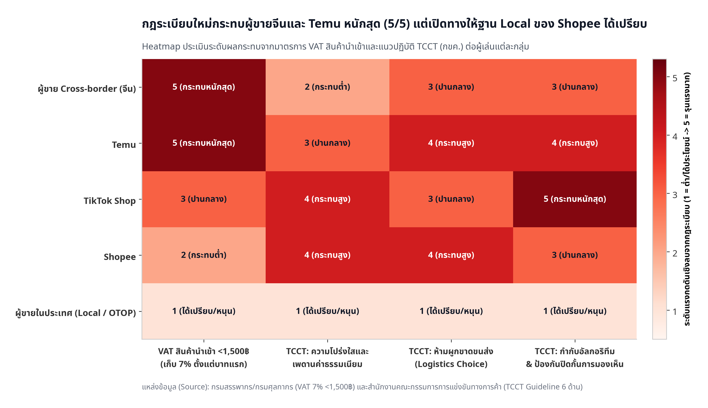

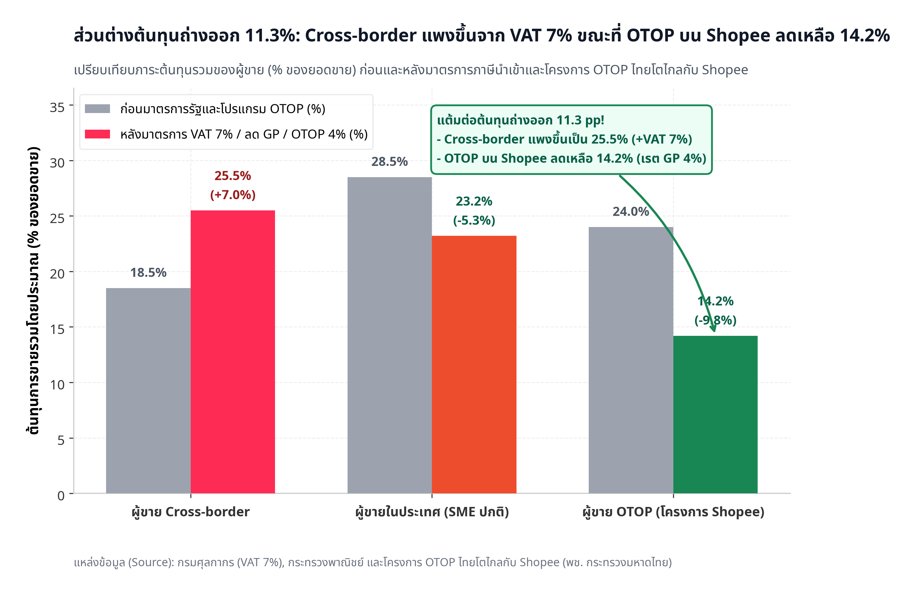

> **Section 4 Insight:** *"กฎใหม่ไม่ใช่แค่ความเสี่ยงด้านการกำกับดูแล — แต่เป็นลมหนุน (Regulatory Tailwind) ที่ทำให้ Moat ของ Shopee (ฐานผู้ขาย Local + OTOP เรต 4% + เครือข่าย SPX Express) มีความได้เปรียบเชิงต้นทุนที่คู่แข่งข้ามชาติเลียนแบบได้ยาก"*

---

### Section 5 — Strategic Options: ควรทำอะไรก่อน
**Business Question:** *ในบรรดาทางเลือกเชิงกลยุทธ์ 4 ทาง ทางเลือกใดให้ผลตอบแทนคุ้มค่าความเสี่ยง (Risk-Adjusted Return) สูงสุดเมื่อเทียบกับขีดความสามารถจริงของ Shopee?*  
**Notebook:** [`notebooks/05_strategic_options.ipynb`](./notebooks/05_strategic_options.ipynb) | **Data:** [`sec05_strategic_options.csv`](./data/processed/sec05_strategic_options.csv), [`sec05_scenarios.csv`](./data/processed/sec05_scenarios.csv)

| Strategic Option (ทางเลือกเชิงกลยุทธ์) | Execution Feasibility (1–10) | Business Impact (1–10) | งบลงทุนประเมิน (Investment) | Risk Level | 18-Month Expected ROI (Worst / Base / Best) |
|---|---|---|---|---|---|
| **(1) Protect Intent-based Base (Search + Mall + SPX)** | **8.5** | **8.8** | ~1,200 ลบ. | ต่ำ (Low) | `+12.0%` / **`+24.5%`** / `+32.0%` |
| **(3) Regulatory Tailwind (Local SME + OTOP 4%)** | **8.8** | **7.9** | ~850 ลบ. | ต่ำ (Low) | `+10.5%` / **`+21.0%`** / `+28.5%` |
| **(2) Selective Shoppertainment & Affiliate** | **7.0** | **7.6** | ~1,800 ลบ. | ปานกลาง (Med) | `+3.5%` / **`+16.0%`** / `+26.0%` |
| **(4) Full-Scale Quick Commerce** | **3.4** | **6.4** | ~3,500 ลบ. | สูง (High) | `-18.0%` / **`+4.5%`** / `+18.0%` |

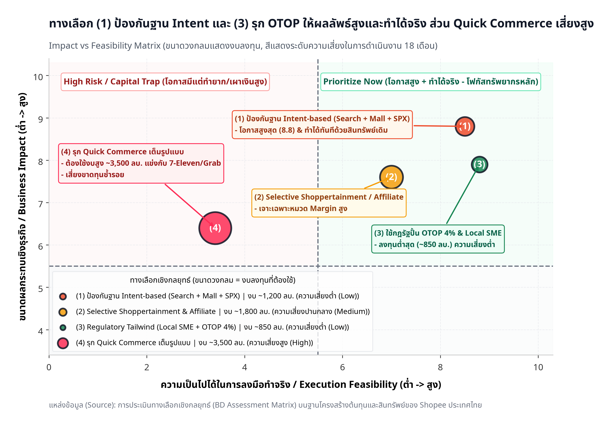

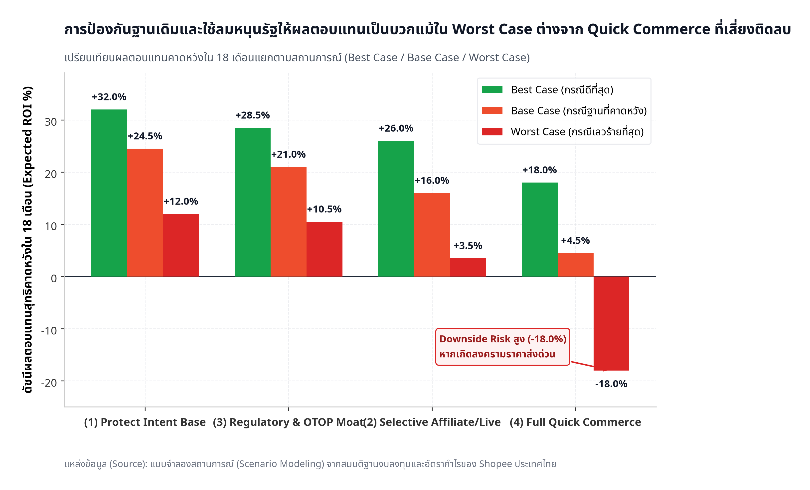

> **Section 5 Insight:** *"การเผาเงินแข่ง Shoppertainment แบบปูพรมเต็มรูปแบบ หรือการเปิดศึก Quick Commerce แข่งกับ 7-Eleven/Grab ให้ ROI ต่ำกว่าและเสี่ยงกว่าการปกป้องฐาน Intent-based เดิมควบคู่กับการใช้ลมหนุนภาครัฐ"*

---

### Section 6 — Recommendation & 18-Month Roadmap
**Business Question:** *สรุป Shopee ควรลงมือทำอะไร เรียงลำดับก่อน-หลังอย่างไรใน 18 เดือนข้างหน้า?*  
**Notebook:** [`notebooks/06_recommendation.ipynb`](./notebooks/06_recommendation.ipynb) | **Data:** [`sec06_roadmap_and_impact.csv`](./data/processed/sec06_roadmap_and_impact.csv) | **Full Memo:** [`memo.md`](./memo.md)

1. **Priority 1 (เดือนที่ 0–12 | สัดส่วนทรัพยากร 50% | Impact Index: 92/100):** **Fortify Intent-Based Core & SPX Express** — ล็อกฐานลูกค้าที่ตั้งใจซื้อสินค้าผ่าน Search และ **Shopee Mall** ด้วยการการันตีของแท้ ระบบคืนของที่ไร้รอยต่อ และการยกระดับ SLA จัดส่งไว (**Next-Day / Same-Day Delivery**) ของ **SPX Express**
2. **Priority 2 (เดือนที่ 2–14 | สัดส่วนทรัพยากร 30% | Impact Index: 84/100):** **Turn Regulation into a Local Moat (OTOP 4% & Thai SMEs)** — เร่งดึงผู้ผลิตไทยและผู้ประกอบการ OTOP เข้าสู่แพลตฟอร์มด้วยแต้มต่อ GP 4% และเครดิตโฆษณา เพื่อสร้างฐานสินค้า Local Exclusive ทดแทนสินค้า Cross-border ที่แพงขึ้นจาก VAT 7%
3. **Priority 3 (เดือนที่ 4–18 | สัดส่วนทรัพยากร 20% | Impact Index: 71/100):** **Surgical Creator Affiliate Defense** — โฟกัสงบ Affiliate Commission และ Live Subsidy เฉพาะหมวดสินค้าที่มี **High Margin** (เช่น Beauty, Fashion, Personal Care) โดยกำหนดเพดาน Subsidy ต่อออเดอร์อย่างชัดเจนเพื่อรักษา Net Take-rate

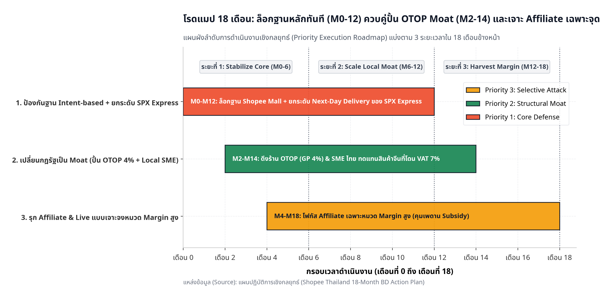

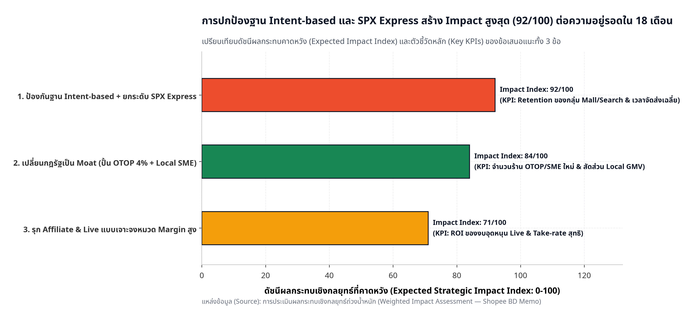

---

## 7. Data Sources & Reconciliation

> ตัวเลขในโปรเจ็คนี้มาจากหลายแหล่งที่มีฐานการคำนวณต่างกัน ตารางนี้แสดงค่าที่ใช้ แหล่งที่มา และเหตุผลที่เลือกใช้ เพื่อให้ผู้อ่านตรวจสอบย้อนกลับได้

| # | Metric | ค่าที่ใช้ในโปรเจ็ค | Source | Base / Definition | ค่าที่พบจากแหล่งอื่น | หมายเหตุ / เหตุผลที่เลือก |
|---|---|---|---|---|---|---|
| 1 | Shopee GMV share 2025 (full year) | 51.8% ($15.9B) | Cube / Momentum Works | Platform GMV ไทย ปี 2025 | บางรายงานระบุ ~50% | ใช้ฐาน full-year 2025 — ระบุให้ชัดว่าไม่ใช่ H1 2026 |
| 2 | TikTok Shop GMV share 2025 | 36.5% ($11.2B) | Cube / Momentum Works | เดียวกัน | บางรายงานระบุ 32% | ⚠️ ต้อง verify ว่าตัว 32% มาจากแหล่งใด — ถ้าต่างกันให้ระบุว่าทำไม |
| 3 | Lazada GMV share 2025 | ต้องตรวจ — ถ้าใช้ $3.6B จากยอดรวม $30.7B = 11.7% | Cube | เดียวกัน | บางรายงานระบุ 18% | ⚠️ จุดที่ต้องแก้: 51.8+36.5+18 = 106.3% เกิน 100 — แสดงว่า 18% มาจากแหล่ง/ฐานอื่น ต้องเลือกแหล่งเดียวและทำให้รวมได้ 100% |
| 4 | GMV share H1 2026 | Shopee 46% / TikTok Shop 46% | Cube | H1 2026 | — | ใช้เป็นหลักฐาน "two-pole market" |
| 5 | GMV share Q2 2026 | TikTok Shop 48% / Shopee 45% | Cube | Q2 2026 | — | จุดที่ TikTok Shop แซงครั้งแรก — ใช้เป็น annotation ในกราฟ 1.1 |
| 6 | User penetration | Shopee 89% / TikTok 71% / Lazada 66% | รายงานข่าว | % ของผู้ใช้อินเทอร์เน็ต (multi-select) | — | ⚠️ ห้ามใช้ปนกับ GMV share — เป็นคนละ metric (คนตอบเลือกได้หลายแพลตฟอร์ม) ควรมี footnote กำกับในกราฟ |
| 7 | Shopee Thailand revenue 2025 | 88,300 ล้านบาท | DBD / รายงานข่าว | งบการเงินบริษัทไทย | — | ใช้ฐานบริษัทจดทะเบียนไทย (ไม่รวม regional) |
| 8 | Shopee Thailand profit 2025 | 2,700 ล้านบาท (-40% YoY) | DBD / รายงานข่าว | งบการเงิน | — | ใช้คู่กับ #9 เพื่อแสดง trend |
| 9 | Shopee Thailand profit 2024 | 4,630 ล้านบาท | DBD / รายงานข่าว | งบการเงิน | — | ฐานเปรียบเทียบ |
| 10 | TikTok Shop loss 2024 | 3,670 ล้านบาท | รายงานข่าว | ประมาณการจากสื่อ | — | ⚠️ ระบุว่าไม่ใช่ตัวเลขจากงบการเงินที่ตรวจสอบแล้ว |
| 11 | TikTok Shop growth H1 2026 | +116% YoY | Cube | GMV H1 2026 vs H1 2025 | — | ใช้ในกราฟ 1.2 |
| 12 | Seller total cost burden | 34.7% (illustrative estimate) | คำนวณเอง จาก fee structure | commission 12.5% + ads 8.5% + logistics 6.0% + promo 4.5% + payment 3.21% | บางรายงานระบุ range 30–35% | ⚠️ ต้องใส่ footnote ในกราฟ 3.2: "Estimated from published fee structure; actual burden varies by category and seller size" |
| 13 | Shopee GP rate | 19.26% → 8.03–13.91% | ประกาศกระทรวงพาณิชย์ | ช่วงมาตรการ 6 เดือน (ธ.ค. 2026 – พ.ค. 2027) | — | ใช้ในกราฟ 3.3 — ระบุช่วงเวลาให้ชัด |
| 14 | TCCT guideline | published 24 มี.ค. 2026 / effective 25 มี.ค. 2026 | TCCT | 6 ด้าน | — | ระบุวันที่ให้เป๊ะ ไม่ใช่แค่ "มี.ค. 2026" |
| 15 | Cross-border tax | ยกเลิก duty exemption 1,500 บาท ตั้งแต่ 1 ม.ค. 2026 + VAT 7% ทุกราคา | กรมศุลกากร / ประกาศราชกิจจานุเบกษา | — | — | ⚠️ แก้ถ้อยคำ: ไม่ใช่แค่ "VAT 7%" แต่คือ "abolishment of 1,500-baht duty exemption" — เป็น structural change |
| 16 | OTOP rate | 4% | ประกาศ Shopee + ภาครัฐ | ผู้ขาย OTOP ที่ผ่านการรับรอง | — | ใช้เป็นหลักฐาน regulatory moat |

> **กฎ:** หากตัวเลขใดในโปรเจ็คขัดกับตารางนี้ ให้ถือว่าตารางนี้เป็น source of truth — และหากพบว่าค่าจากแหล่งอื่นน่าเชื่อถือกว่า ให้อัปเดตทั้งตารางและกราฟที่เกี่ยวข้องพร้อมกัน

---

## 8. Early Warning Indicators

> ข้อเสนอนี้ตั้งอยู่บนสมมติฐานที่อาจเปลี่ยนได้ ตารางนี้ระบุสัญญาณที่บ่งบอกว่าควรทบทวนแผน ก่อนที่ต้นทุนของการตัดสินใจผิดจะสูงเกินไป

| # | Indicator | Baseline (ปัจจุบัน) | Trigger Threshold | สิ่งที่ต้องเปลี่ยนถ้า trigger | แหล่งติดตาม | ความถี่ |
|---|---|---|---|---|---|---|
| 1 | TikTok Shop unit economics | ยังขาดทุน (3.67B ปี 2024) | ประกาศ profitability หรือ positive unit economics ภายใน 12 เดือน | ทบทวนสมมติฐาน "TikTok Shop เผาเงิน" — อาจต้องยกระดับ Selective Attack เป็น 40% | งบการเงิน / ข่าว / รายงาน分析师 | รายไตรมาส |
| 2 | ส่วนต่าง GMV share Shopee vs TikTok Shop | TikTok Shop นำ 3 pp (48 vs 45) | ห่างเกิน 5 pp ติดกัน 2 ไตรมาส | จาก "parity" → "structural loss of leadership" — ต้องเปลี่ยน 50:30:20 เป็น defensive emergency | Cube / Momentum Works | รายไตรมาส |
| 3 | Shopee Thailand profit | 2.7B บาท | ต่ำกว่า 1.5B หรือติดลบ | Core Defense ล้มเหลว — ต้องตัด Selective Attack ทั้งหมดและ focus profitability | DBD / งบการเงิน | รายปี |
| 4 | มาตรการลด GP | 6 เดือน (ธ.ค. 2026 – พ.ค. 2027) | ถูกขยายเกิน พ.ค. 2027 หรือกลายเป็นถาวร | Regulatory tailwind กลายเป็น permanent cost structure — ต้องประเมิน moat ของ OTOP ใหม่ | ประกาศกระทรวงพาณิชย์ | เมื่อมีประกาศ |
| 5 | Temu GMV share ไทย | marginal (<2–3% ประมาณ) | เกิน 5% | ยกระดับจาก "watchlist" เป็น "active threat" — ต้องเพิ่ม resource ด้านราคา | รายงานตลาด / MAU proxy | รายครึ่งปี |
| 6 | การย้ายแพลตฟอร์มของผู้ขายรายใหญ่ | ไม่มีข้อมูล systematic | มีผู้ขาย top-tier ประกาศย้าย/ลดการขายบน Shopee มากกว่า 3 รายใน 1 ไตรมาส | Ecosystem risk กำลังเป็นจริง — ต้องเร่ง Seller Retention ก่อนกำหนด | ประกาศผู้ขาย / FB group ผู้ขาย / ข่าว | รายไตรมาส |
| 7 | TCCT enforcement | ยังไม่มีคดี | TCCT เปิดกรณีสอบสวน Shopee เรื่องบังคับใช้ SPX / algorithm | SPX moat เสี่ยงถูก unbundle — ต้องเตรียมแผนสำรองด้านโลจิสติกส์ | ประกาศ TCCT | เมื่อมีเหตุการณ์ |
| 8 | การรับสมัคร OTOP | เพิ่งเริ่ม | adoption ต่ำกว่าเป้า >50% หลัง 6 เดือน | Regulatory moat thesis อ่อนลง — ต้องหาช่องทางจูงใจผู้ขาย本土 ทางอื่น | Shopee Seller Centre / ข่าว | รายครึ่งปี |
| 9 | ROI ของ Affiliate / KOS | ยังไม่วัด | CAC ผ่าน affiliate สูงกว่า organic >2 เท่า | Selective Attack ไม่คุ้ม — ตัดงบ 20% กลับไป Core Defense | Internal data (ถ้ามี) / benchmark อุตสาหกรรม | รายไตรมาส |
| 10 | ต้นทุนผู้ขาย cross-border หลังภาษีใหม่ | คาดว่าเพิ่มขึ้น | ผู้ขาย cross-border ยังอยู่และดูดซับต้นทุนได้ (ไม่ย้ายออก) | Regulatory moat thesis อ่อนลง — VAT ไม่ได้กัดคู่แข่งเท่าที่คิด | รายงานตลาด / จำนวนผู้ขาย cross-border | รายครึ่งปี |

> ตารางนี้ไม่ได้หมายความว่าแผนปัจจุบันผิด — แต่หมายความว่าแผนที่ดีต้องมีจุดที่พร้อมจะเปลี่ยน ไม่ใช่ยึดคำตอบเดิมจนหลักฐานชัดว่าไม่จริง

---

## 9. Data Limitations

- ตัวเลข GMV จาก Cube เป็น estimation ไม่ใช่ตัวเลขทางการของแพลตฟอร์ม
- ตัวเลขกำไร/ขาดทุนของ TikTok Shop มาจากสื่อ ไม่ได้ตรวจสอบจากงบการเงิน
- ตัวเลขต้นทุนผู้ขาย 34.7% เป็น illustrative estimate จาก fee structure ที่ประกาศ publicly

---

## Verified Public Data Sources (แหล่งข้อมูลสาธารณะที่ใช้อ้างอิง)

การวิเคราะห์และกราฟทั้งหมดในโปรเจ็คนี้ปฏิบัติตาม **Data Policy (ใช้ข้อมูลสาธารณะจริง + ระบุแหล่งที่มาชัดเจน ไม่ใช้ Synthetic Dataset)** โดยมีรายละเอียดครบถ้วนใน [`data/raw/data_sources_and_notes.md`](./data/raw/data_sources_and_notes.md):
- **Market Share & GMV Growth:** Cube Asia (*Tradewinds Dataset 2024–H1 2026*) และ Momentum Works (*Ecommerce in Southeast Asia 2024–2025*)
- **Corporate Financials (งบการเงินนิติบุคคลไทย):** กรมพัฒนาธุรกิจการค้า (DBD DataWarehouse+) และ Creden Data สำหรับ *บจก. ช้อปปี้ (ประเทศไทย)* (ปี 2565–2568), *บจก. เอสพีเอ็กซ์ เอ็กซ์เพรส (ประเทศไทย)*, *บจก. ลาซาด้า* และ *บจก. ติ๊กต๊อก ช็อป (ประเทศไทย)*
- **Seller Fee Structure & GP Cap:** Shopee Seller Centre Thailand, FlowAccount E-Commerce Benchmarks และประกาศกระทรวงพาณิชย์ / กรมประชาสัมพันธ์ (`19.26% -> 8.03%–13.91%`)
- **Regulatory & OTOP Programs:** กรมสรรพากรและกรมศุลกากร (มาตรการ VAT 7% สินค้านำเข้า `<1,500 บาท`), สำนักงานคณะกรรมการการแข่งขันทางการค้า (TCCT Guideline 6 ด้าน) และกรมการพัฒนาชุมชน กระทรวงมหาดไทย (โครงการ OTOP ไทยโตไกลกับ Shopee เรต GP 4.00%)
- **Temu Metrics:** AppMagic และ Business of Apps (ยอดดาวน์โหลดสะสมในไทย >10 ล้านครั้ง, GMV Share <3%)

---

## Repository Structure & Reproducibility (โครงสร้างโปรเจ็คและการรันโค้ด)

```text
shopee-bd-analysis/
├── data/
│   ├── raw/                  # ข้อมูลดิบที่ผ่านการตรวจสอบ + เอกสารระบุแหล่งที่มา (Source Notes)
│   │   ├── data_sources_and_notes.md
│   │   ├── raw_dbd_financials.csv
│   │   ├── raw_fees_and_regulations.csv
│   │   └── raw_market_gmv.csv
│   └── processed/            # ตารางข้อมูลที่ Clean แล้ว แยกตาม Section 1–6
│       ├── sec01_gmv_quarterly.csv
│       ├── sec01_yoy_growth.csv
│       ├── sec02_competitor_financials.csv
│       ├── sec02_threat_matrix.csv
│       ├── sec03_gp_reduction.csv
│       ├── sec03_seller_cost_burden.csv
│       ├── sec03_shopee_financial_trend.csv
│       ├── sec04_cost_shift.csv
│       ├── sec04_regulatory_heatmap.csv
│       ├── sec05_scenarios.csv
│       ├── sec05_strategic_options.csv
│       └── sec06_roadmap_and_impact.csv
├── notebooks/                # Jupyter Notebooks ทั้ง 6 ส่วน + โมดูลตั้งค่ากราฟ
│   ├── chart_style.py
│   ├── 01_market_shift.ipynb
│   ├── 02_threat_landscape.ipynb
│   ├── 03_internal_pressure.ipynb
│   ├── 04_regulatory_wind.ipynb
│   ├── 05_strategic_options.ipynb
│   └── 06_recommendation.ipynb
├── charts/                   # กราฟ Matplotlib (PNG ความละเอียด 300 DPI ทั้ง 13 กราฟ)
├── memo.md                   # 1-Page Executive BD Memo สำหรับผู้บริหาร Shopee
└── README.md                 # สรุปภาพรวมโปรเจ็ค, Storyline, Methodology และข้อเสนอแนะ
```

### วิธีรันโค้ดเพื่อสร้างกราฟและรัน Notebooks ใหม่ (How to Run Locally)
```bash
cd shopee-bd-analysis
uv venv .venv
uv pip install pandas matplotlib nbformat nbclient ipykernel fonttools
.venv/bin/python notebooks/generate_all_notebooks.py
```
